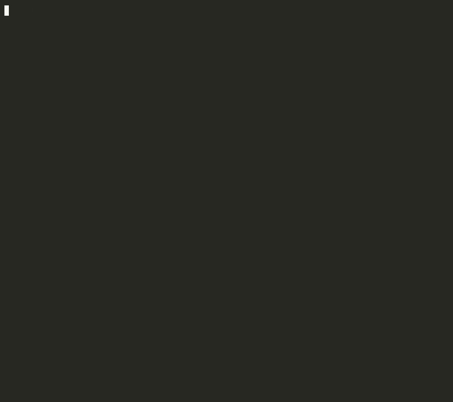

# aishare

**How much of the code you shipped did AI write?** aishare looks at every line git blames on you this year that's still in your code, and works out which ones came from Claude Code, Codex, Gemini CLI, Copilot, Cursor and friends.

```bash
uvx aishare ~/code
```

<p align="center"></p>

<sub>Demo on a made-up developer's year (three repos plus agent logs) generated by <a href="docs/demo.py">docs/demo.py</a>. Run it on your own code to get your number.</sub>

## How it knows

Two independent signals, both read locally:

1. **Agent session logs.** Coding agents keep a transcript of every file they write or edit. aishare reads them and records the exact lines each agent produced, per file, and when:
   - **Claude Code**: `~/.claude/projects/*/*.jsonl` (`Write`, `Edit`, `MultiEdit`)
   - **Codex CLI**: `~/.codex/sessions/**/rollout-*.jsonl` (`apply_patch`)
   - **Gemini CLI**: `~/.gemini/tmp/*/chats/session-*` (`write_file`, `replace`)

   Then it runs `git blame` on the files you changed in the period. A line counts as AI-written if an agent wrote that exact line (ignoring whitespace) into that file **before** the commit that introduced it. Lines you wrote earlier that an agent merely re-saved don't count, and lines you later rewrote by hand become yours.

2. **AI co-author trailers.** Commits that say `Co-authored-by: Claude / Copilot / Cursor Agent / Codex / Gemini / Aider / Devin…` or "Generated with Claude Code", plus commits authored by agent bots (Copilot coding agent, Devin, Jules).

Only substantive lines count: blank lines, lone braces and the like are skipped on both sides, and lockfiles, minified files and build output are ignored.

## What it can't see

- **Inline autocomplete** (Copilot, Cursor Tab, Supermaven) leaves no log or trailer, so it's counted as yours. Real numbers are usually higher.
- **Chat copy-paste** from ChatGPT or Claude.ai in a browser.
- **Agents that don't keep local logs.** Cursor stores its history in a database, not supported yet.

So treat the result as a floor.

## Options

```
aishare                          # the repo you're in
aishare ~/code                   # every repo under a folder
aishare --since 2026-06          # a different window (YYYY, YYYY-MM or YYYY-MM-DD)
aishare --email old@work.com     # also count commits under another email
aishare --json                   # numbers for scripts
```

It uses your global `git config user.email` and `user.name` to decide which lines are yours.

## Privacy

Everything runs on your machine. aishare reads git and your agents' log files and sends nothing anywhere.

## Install

```bash
uvx aishare           # run without installing
pipx install aishare  # or install it
```

Requires Python 3.9+ and git. The only dependency is `rich`.

## License

MIT
